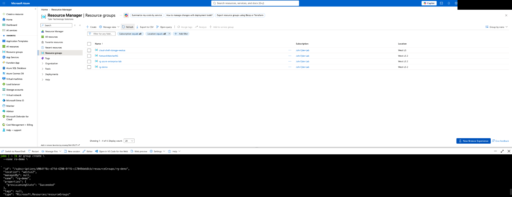
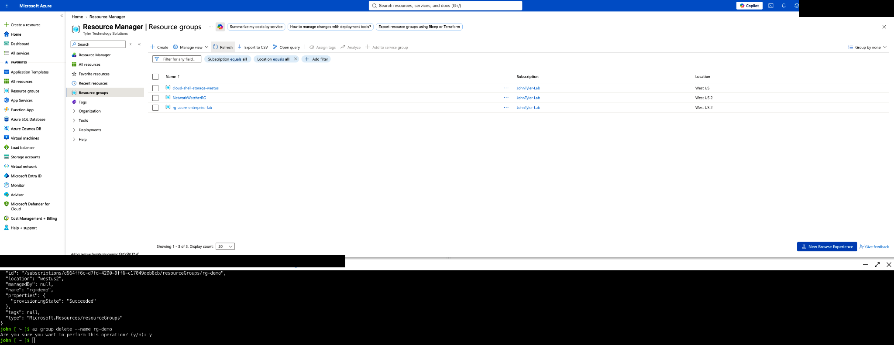

# Azure CLI Resource Group Lifecycle Lab

A hands-on Microsoft Azure lab demonstrating the lifecycle of an Azure Resource Group using **Azure CLI in Azure Cloud Shell**, with verification in the **Azure Portal**.

## Lab Objective

The goal of this lab was to practice a basic but important cloud administration workflow:

1. Create an Azure Resource Group with Azure CLI.
2. Verify the resource group was provisioned successfully.
3. Confirm the resource group appeared in the Azure Portal.
4. Delete the resource group with Azure CLI.
5. Verify the resource group was removed from the Azure Portal.

## Technologies Used

- Microsoft Azure
- Azure CLI
- Azure Cloud Shell
- Azure Resource Manager
- Azure Portal

## Resource Group Creation

The following Azure CLI command created a resource group named `rg-demo` in the `westus2` region:

```bash
az group create \
  --name rg-demo \
  --location westus2
```

Azure CLI returned a successful provisioning state, and the Azure Portal showed `rg-demo` in the Resource Groups list.



## Resource Group Deletion

After validating the resource group, it was removed with:

```bash
az group delete --name rg-demo
```

Azure CLI requested confirmation before deletion:

```text
Are you sure you want to perform this operation? (y/n): y
```

After the deletion completed, the Azure Portal no longer displayed `rg-demo` in the Resource Groups list.



## Commands

A concise command reference is available in [`commands/azure-cli-commands.md`](commands/azure-cli-commands.md).

## Skills Demonstrated

- Azure Cloud Shell navigation
- Azure CLI syntax and command execution
- Azure Resource Group provisioning
- Azure Resource Manager fundamentals
- Azure region selection
- Verification of cloud resources in the Azure Portal
- Safe resource deletion and lifecycle management
- Basic cloud administration workflow

## What I Learned

This lab reinforced the relationship between command-line administration and portal-based verification in Azure. It also demonstrated a core cloud engineering workflow: provision infrastructure, validate the deployment, remove the resource when it is no longer required, and verify that cleanup completed successfully.

## Security Note

Screenshots in this repository are intentionally sanitized to avoid publishing unnecessary account and subscription identifiers.

---

**Author:** John Tyler  
**Focus:** Azure Administration | Cloud Engineering | Identity & Security
